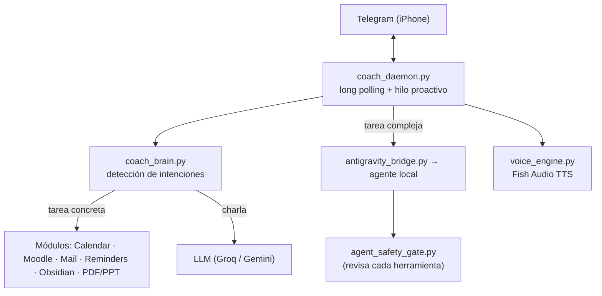

# Life OS · Asistente personal en Telegram

Asistente personal que corre en mi Mac y conversa conmigo por **Telegram**: organiza la agenda, sigue las tareas de la universidad, crea recordatorios en el iPhone, responde con notas de voz y delega las tareas complejas a un agente de IA local, con un control de seguridad que revisa cada acción antes de ejecutarla.

Lo construí para resolver un problema propio: trabajo, estudio y familia repartidos entre Moodle, dos correos, Google Calendar y el teléfono. La idea es tener **un solo chat** donde preguntar "¿qué tengo mañana?" o decir "recuérdame a las 20:30 entregar el informe".

> 📸 _Agrega aquí una captura del chat de Telegram (con datos de ejemplo)._

## Qué hace

- **Conversación en Telegram:** texto, notas de voz (transcritas), fotos y documentos, desde un único chat autorizado.
- **Agenda:** consulta, crea, mueve y borra eventos de Google Calendar en lenguaje natural ("el viernes a las 15:00 dentista"), y busca bloques libres.
- **Universidad:** sincroniza el calendario de Moodle (iCal), escanea el correo institucional y el personal en Apple Mail, y detecta tareas con fecha de entrega, descartando encuestas y avisos.
- **Recordatorios proactivos:** briefing matutino, check-in nocturno, alerta una hora antes de cada evento y avisos diarios configurables.
- **Apple Reminders:** los recordatorios aparecen también en el iPhone.
- **Notas de voz:** respuestas con voz sintética (Fish Audio) en formato `.ogg` Opus, con distintos modos de entonación.
- **Documentos de estudio:** convierte PPT y PDF y arma un paquete con prompt para NotebookLM; genera presentaciones PowerPoint y tarjetas visuales.
- **Memoria y Obsidian:** guarda notas de largo plazo y escribe en la nota diaria del vault.
- **Auditoría diaria:** a las 23:00 revisa todas las interacciones del día y genera un informe en PDF.

## Arquitectura



**Flujo de una tarea compleja:** el daemon responde al instante ("me pongo en ello"), lanza al agente en un hilo aparte con el historial reciente como contexto y envía avisos de progreso mientras trabaja. El agente debe devolver un JSON con burbujas, voz, imagen o documento (ver `GUIA_E_INDICE_MAESTRO.example.md`).

## Seguridad

Un asistente que lee correos y ejecuta herramientas puede ser atacado con instrucciones escondidas en un correo o en una página. Por eso:

- **`agent_safety_gate.py`** es un hook `PreToolUse` que revisa cada herramienta antes de ejecutarla: bloquea el acceso a secretos y credenciales, la red no controlada, los envíos de correo, las compras, los borrados y cualquier cambio al propio mecanismo de control. Ante un error, **falla cerrado** (deniega) y registra cada decisión.
- Solo responde a **un chat de Telegram** (`TELEGRAM_CHAT_ID`) y descarta el resto.
- **`env_loader.py`** carga los secretos desde `.env` y **redacta los tokens en los logs**.
- Los archivos que se envían por el chat pasan por una lista de rutas permitidas.

## Stack

Python 3 (`requests`, Pillow, python-pptx, pypdf) · Telegram Bot API · AppleScript (Mail, Reminders, Chrome) · Google Calendar · Moodle (iCal) · Groq y Gemini · Fish Audio · Obsidian.

## Puesta en marcha (macOS)

```sh
pip3 install -r requirements.txt
cp .env.example .env                                  # tokens y claves
cp config/config.example.json config/config.json      # nombre, correos, horarios
cp GUIA_E_INDICE_MAESTRO.example.md GUIA_E_INDICE_MAESTRO.md
python3 scripts/coach_daemon.py
```

- Crea el bot con @BotFather y pon tu ID de chat en `TELEGRAM_CHAT_ID`.
- Para el agente local, registra el hook de `.agents/hooks.example.json` con la ruta real del proyecto.
- Los datos personales viven solo en `.env`, `config/config.json`, `memoria/` y la guía maestra, y todos están en `.gitignore`.

### Pruebas

```sh
python3 scripts/test_dialog_engine.py   # motor de diálogo: tono, tareas asíncronas, tasa de audio
python3 smoke_test.py                   # prueba rápida de agenda, fechas y memoria
```

## Autor

**Luis Paria** · [LinkedIn](https://www.linkedin.com/in/parialuis/) · [Portafolio](https://lavields.github.io/CV/)
